# Humanitarian Information-Management Portfolio
### Data management, quality assurance and reporting for an area-based transitional-shelter programme (Gaza Strip)

> **All data in this repository are simulated.** Sites, households, workers, ID numbers and phone numbers are randomly generated by `python/generate_sample_data.py`. No real beneficiary information is included.

This project rebuilds, end to end, the information flow a programme data assistant manages every week. Field engineers, contractors, community mobilisers and cash-for-work supervisors each submit data. The project collects it, validates it, reconciles the sources, logs every data-quality issue, and turns the result into trackers, dashboards and maps that managers can use.

| Capability | Where to look |
|---|---|
| Mobile data collection (KoboToolbox / ODK) | `kobo/ITCN_Site_Monitoring_XLSForm.xlsx`: bilingual EN/AR form with cascading selects, GPS constrained to Gaza, skip logic, cross-field validation, consent gate |
| Data cleaning & validation | `python/clean_and_reconcile.py`: ID normalisation, duplicates, impossible values, future dates, check-digit validation, phone normalisation |
| Multi-source reconciliation | Field-engineer figures vs contractor figures, classified as Match / Minor gap / Major gap |
| Data-quality log | `outputs/data_quality_log.csv`: one row per issue with DQ dimension, action taken and follow-up status |
| Excel tracker | `excel/ITCN_IM_Tracker.xlsx`: site register, activity tracker, reconciliation, DQ log, live summary (INDEX/MATCH, SUMIFS, COUNTIFS, data validation, conditional formatting, structured tables) |
| Dashboard | `powerbi/`: data model + Power BI dashboard |
| GIS | `gis/itcn_sites.geojson`: validated site points for QGIS / ArcGIS |
| Data protection | Shared outputs are pseudonymised: names, ID numbers and phones never leave the registry; records without consent are excluded |
| Temporary employment | Cash-for-work attendance cleaned and converted to workdays generated, by site and gender |

---

## Data flow

```
 Field engineers (Kobo) ─┐
 Contractor reports ─────┤                      ┌─► Excel IM tracker
 Household registry ─────┼─► clean_and_reconcile.py ─┼─► Power BI dashboard
 CfW attendance ─────────┤   (validate · dedupe ·    ├─► GIS layer (GeoJSON)
 Site register ──────────┘    reconcile · log)       └─► DQ log + monthly DQ report
```

## Results on the simulated dataset (reporting week ending 2 Nov 2026)

| Item | Value |
|---|---|
| Sites in register | 30 (2 coordinate problems detected; 1 auto-corrected swap) |
| Field reports received / accepted | 1,289 / 1,275 |
| Households in shared dataset (consented, pseudonymised) | 7,176 |
| Relief Housing Units installed / target | 2,021 / 2,308 (88%) |
| Cash-for-work workers / workdays generated | 240 / 4,787 |
| Data-quality issues logged | 431 (79 auto-corrected, 352 routed for field follow-up) |
| Field vs contractor (latest week) | 101 match · 21 minor gap · 6 major gap → joint verification |

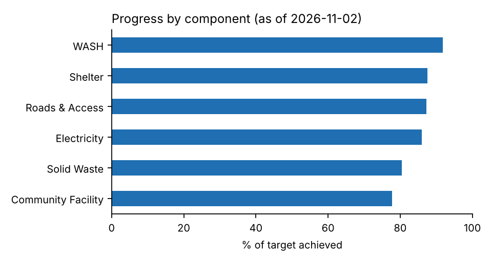
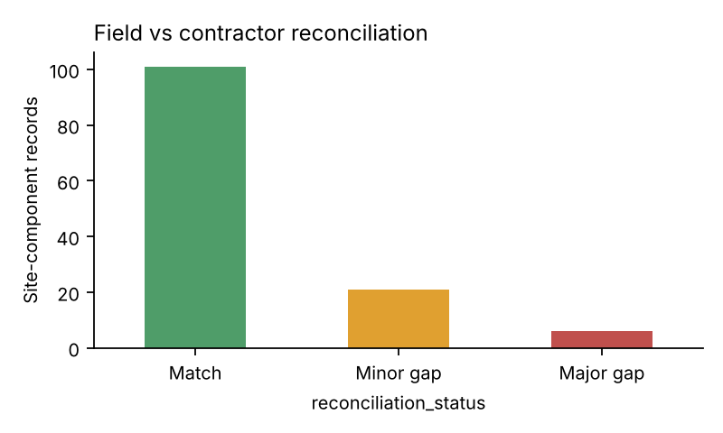
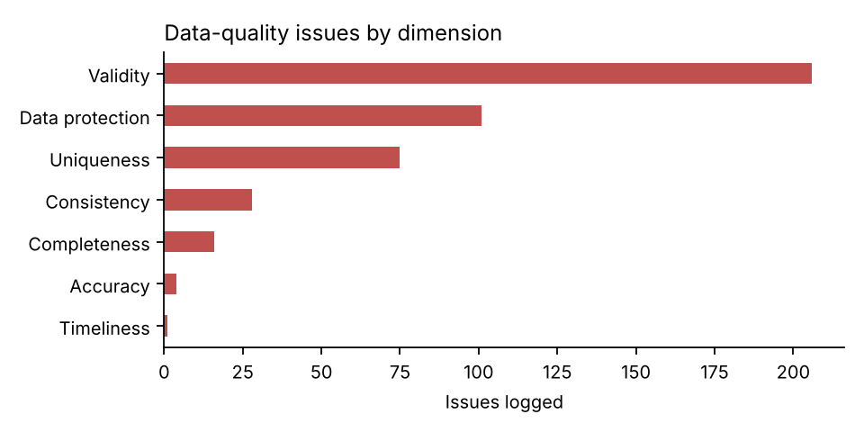

### Power BI dashboard
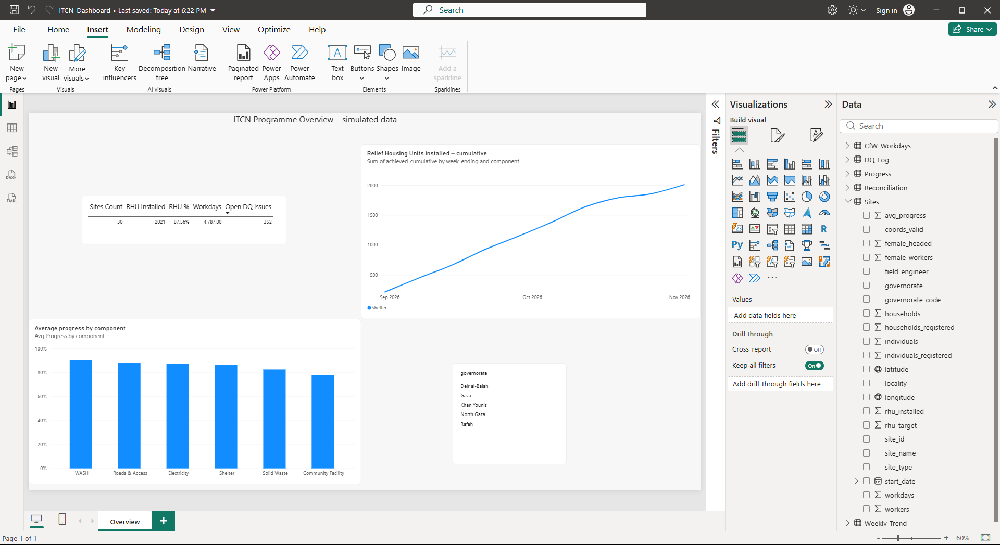

### QGIS site map
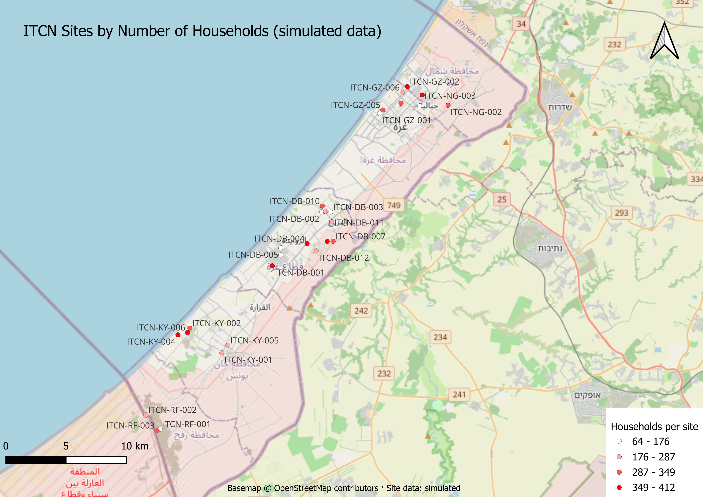

### KoboToolbox form and test submissions
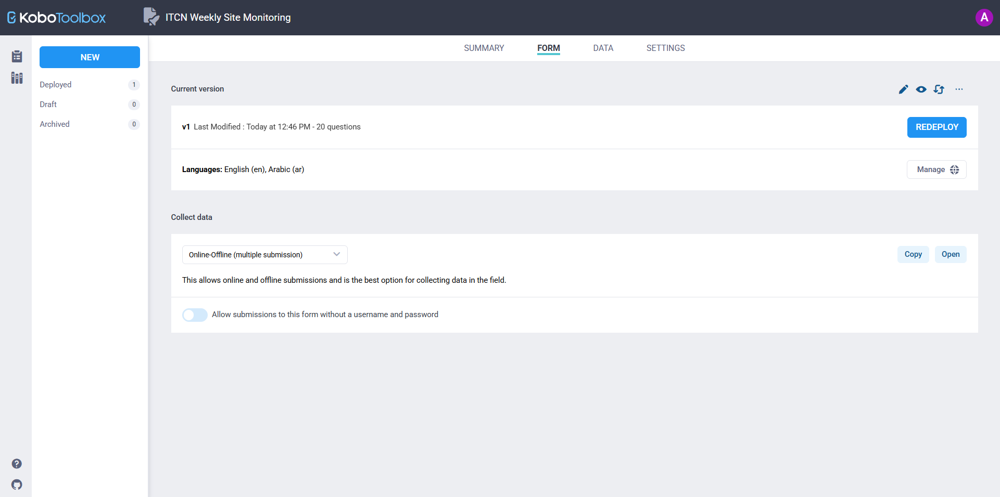
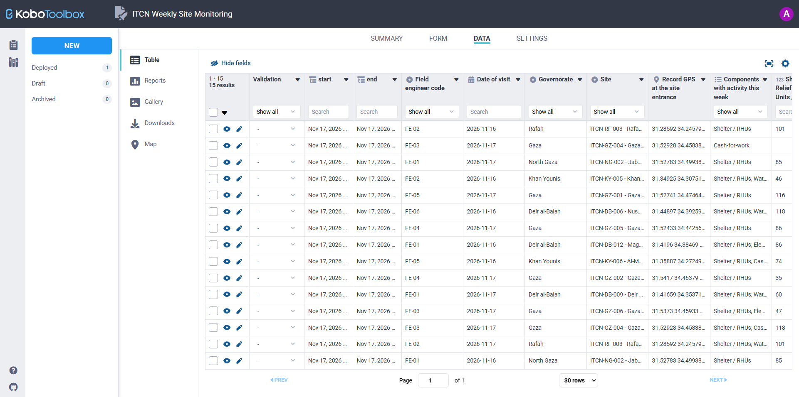
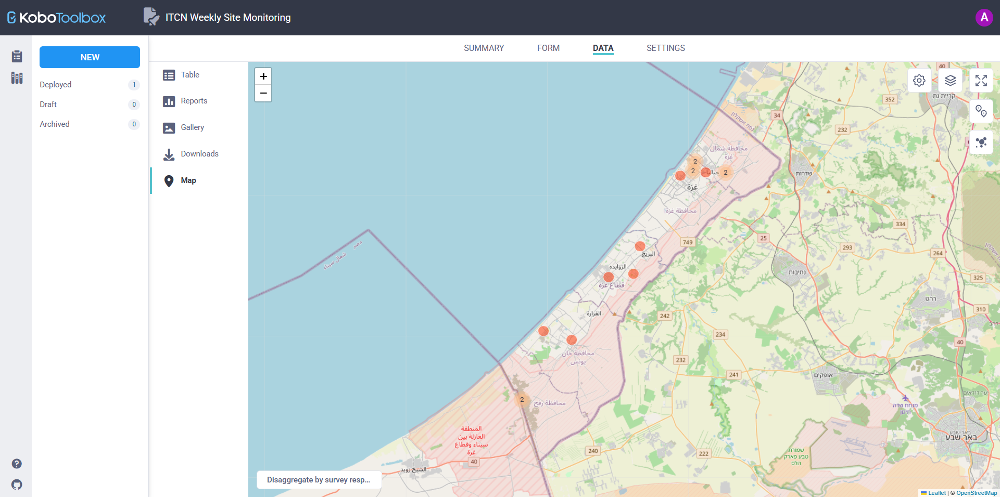

### Validation rules rejecting bad entries at collection
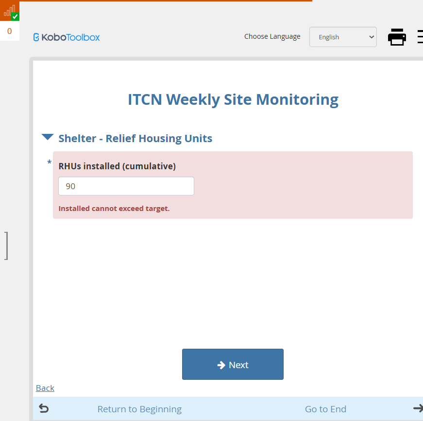
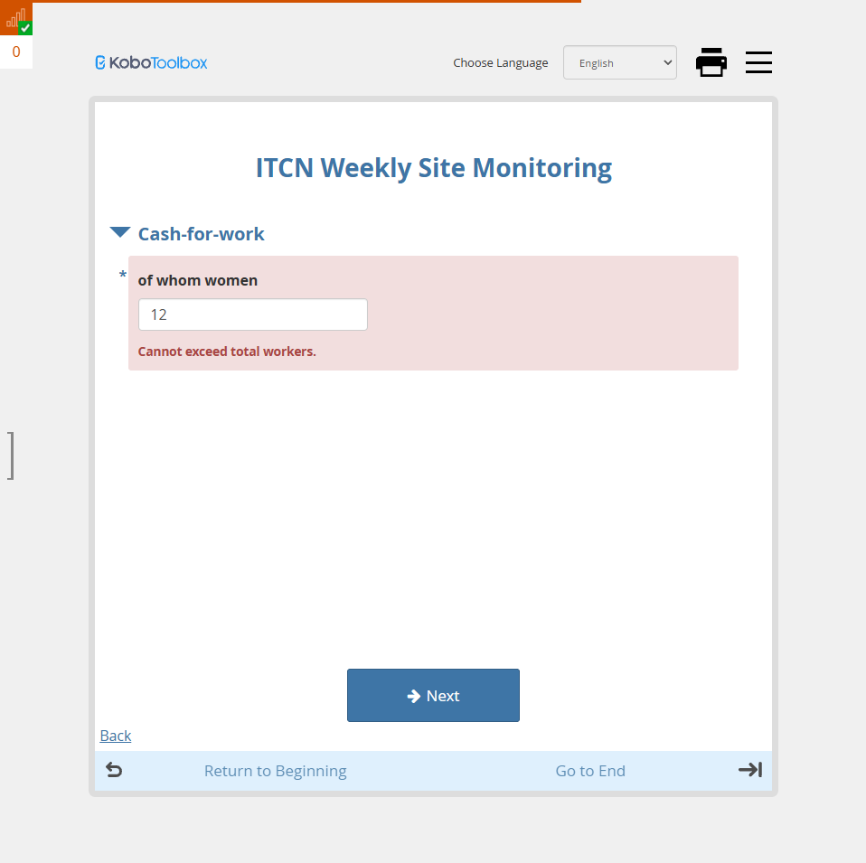
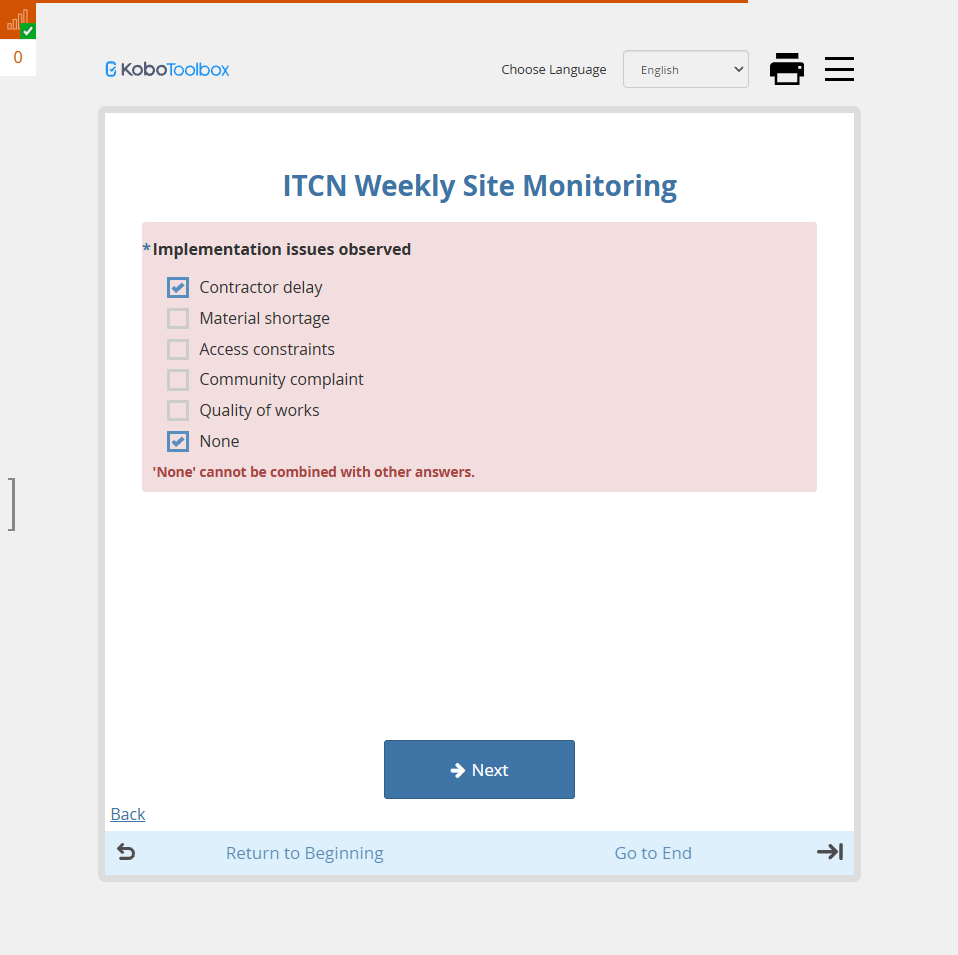

## Data-quality checks implemented

| Dimension | Checks |
|---|---|
| Validity | Site-ID pattern, unknown sites, negative values, hours > 8/day, ID check digit, phone format, household size = 0 |
| Accuracy | Coordinates inside the Gaza Strip, lat/lon swaps, achievement above target |
| Completeness | Missing coordinates, missing gender |
| Consistency | Governorate vs site code, category spelling, cumulative values that decrease, field vs contractor gaps |
| Uniqueness | Duplicate submissions, the same worker twice on one day, the same household registered at two sites |
| Timeliness | Report dates after the reporting period |
| Data protection | Records without consent excluded from shared datasets |

## How to run

```bash
pip install -r requirements.txt
cd python
python generate_sample_data.py     # simulated raw data -> data/raw, data/reference
python clean_and_reconcile.py      # clean, validate, reconcile -> outputs/, gis/, powerbi/
python build_excel_tracker.py      # -> excel/ITCN_IM_Tracker.xlsx
python build_xlsform.py            # -> kobo/ITCN_Site_Monitoring_XLSForm.xlsx
```

## Repository structure

```
data/raw/            simulated submissions (with deliberate errors)
data/reference/      master lists: site register, targets, worker register
python/              generation, cleaning/reconciliation and build scripts
outputs/             clean datasets, DQ log, reconciliation, DQ report, charts
excel/               Excel information-management tracker
kobo/                KoboToolbox XLSForm
powerbi/             Power BI data model (+ .pbix and screenshots)
gis/                 GeoJSON / CSV site layers for QGIS
docs/                data dictionary, screenshots
```

## Tools
Python (pandas, matplotlib, openpyxl) · Microsoft Excel · KoboToolbox / XLSForm · Power BI · QGIS · Git/GitHub · AI-assisted development (Claude Code) for code generation and review

---
**Author:** Ahmed M. O. Jalambo · Computer Systems Engineering (BSc, ranked 1st) · Gaza, Palestine · [LinkedIn](https://linkedin.com/in/ahmed-jalambo)
